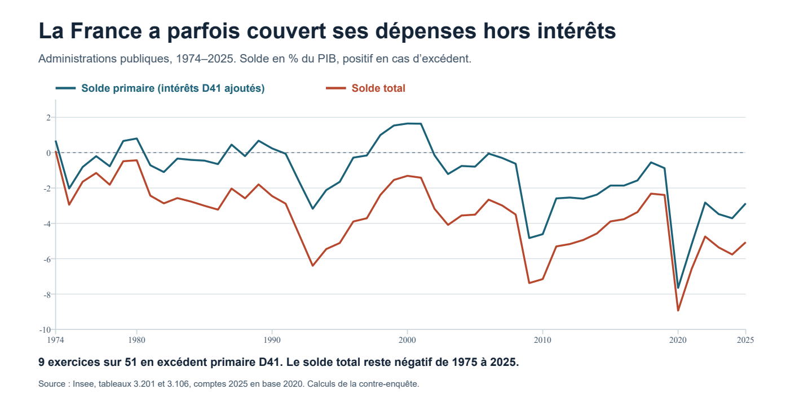

# Pourquoi le déficit français a-t-il duré 51 ans ?

**Contre-enquête indépendante du Constat. France, 1975–2025. Documents et prévisions arrêtés au 20 novembre 2026.**

En **1980**, il manquait 1,94 milliard d’euros courants, soit **0,43 % du PIB**, pour équilibrer les comptes publics. Cette année-là, les administrations couvraient leurs dépenses hors intérêts. En **2000**, malgré 4,14 % de croissance réelle, il manquait 19,34 milliards dans les comptes révisés. Les administrations dégageaient pourtant un excédent primaire de 1,65 % du PIB. En **2025**, même en ajoutant aux recettes l’équivalent de tous les intérêts versés, il manquait encore **85,87 milliards**. Ces trois comptes portent la même mention « déficit ». Ils demandent trois explications différentes. [Chronologie des 51 exercices et années de référence](01_chronologie_1974_2026.md) · [Insee, soldes et dette](https://www.insee.fr/fr/statistiques/8988843) · [Insee, intérêts et dépenses](https://www.insee.fr/fr/statistiques/8988845)

Notre conclusion est que **les redressements ont été réels, mais leurs sources ont varié et leur ampleur a rarement suffi à absorber à la fois les intérêts hérités et le choc suivant**. Trois mécanismes sont directement observables. Les périodes de faible croissance ont ralenti les assiettes tandis que prestations et intérêts continuaient à être servis. Des décisions identifiables ont engagé des recettes ou des dépenses au-delà de l’exercice où elles étaient votées. Enfin, une partie des variations que l’on attribue au comportement d’un gouvernement relève du calendrier de comptabilisation, des prix ou d’opérations financières. Le poids causal de chaque mécanisme dépend de la période. La preuve est beaucoup plus forte pour certaines décisions et certains bénéficiaires que pour une explication politique générale. [Douze reconstitutions historiques](histoire.md) · [Dossiers d’incidence](incidence.md) · [Arbitrage des contradictions](contradictions.md)

## 1. La rupture de 1975 et la première occasion de fermeture

1975 ouvre la série ininterrompue. La France avait déjà enregistré des déficits en 1967, 1968, 1969, 1971 et 1973. En 1974, l’excédent n’était que de 0,10 point de PIB. Dès 1975, la production réelle recule de 0,95 %, mais le PIB nominal augmente encore de 12,68 %. Dire simplement que « le PIB a baissé, donc le ratio de dépenses a monté » confond volumes et prix. Le poids des dépenses primaires monte de 4,52 points, dont 2,66 pour les prestations et autres transferts, tandis que celui des recettes augmente de 1,81. La charge des intérêts ajoute 0,33 point à la dégradation. La relance de septembre inclut des versements ciblés et des déplacements de calendrier. Son impulsion nette et ce qu’aurait été l’emploi sans elle restent à distinguer du coût brut annoncé. [Insee, note d’avril 1976, chap. IV](https://www.insee.fr/fr/statistiques/fichier/1408808/f3_7604.pdf) · [Pont 1974–75](calculs/ponts_points_pib.csv)

De 1975 à 1980, le solde récupère **2,52 des 3,04 points** perdus à la rupture. Le poids des recettes progresse de 4,37 points et celui des dépenses primaires de 1,54. Les plans de financement de la protection sociale et la reprise des assiettes s’observent dans les archives. Des droits nouveaux sont aussi ouverts. Entre 1980 et 1985 l’écart se rouvre de 2,57 points, avec +4,82 points de dépenses primaires et +1,32 d’intérêts, malgré +3,57 de recettes. Le chômage BIT passe de 3,6 % des actifs en 1975 à 9,1 % en 1985. Les comptes ne permettent pas de dessiner une trajectoire sans plans de relance, sans choc externe ou sans réforme des pensions en ne changeant qu’une seule de ces variables. [Sénat, chronologie des plans](https://www.senat.fr/rap/r98-433/r98-4331.html) · [Insee, enquête Emploi 2025, figures 1 et 5](https://www.insee.fr/fr/statistiques/8901327) · [Histoire, études 1 à 4](histoire.md)

## 2. Pourquoi les corrections n’ont pas toutes conduit au même résultat

| Fenêtre | Solde, variation en points de PIB | Recettes | Contribution de la variation de dépense primaire | Contribution des intérêts |
|---|---:|---:|---:|---:|
| 1985–1993 | −3,39 | −1,04 | −1,68 | −0,67 |
| 1993–2000 | +5,09 | +1,17 | +3,66 | +0,26 |
| 2000–2007 | −1,68 | −0,67 | −1,28 | +0,27 |
| 2007–2009 | −4,39 | −0,03 | −4,50 | +0,14 |
| 2011–2015 | +1,41 | +2,00 | −1,27 | +0,68 |
| 2015–2019 | +1,50 | −0,75 | +1,74 | +0,52 |
| 2019–2020 | −6,54 | −0,19 | −6,59 | +0,23 |
| 2020–2023 | +3,57 | −1,37 | +5,55 | −0,60 |
| 2024–2025 | +0,69 | +1,02 | −0,18 | −0,15 |

Chaque ligne rapproche deux exercices de la même série consolidée révisée. Les signes des deux dernières colonnes indiquent leur contribution au solde. Une dépense qui croît moins vite que le PIB peut avoir une contribution positive. Les fenêtres se recoupent partiellement avec des réformes, des reprises, des variations d’inflation et des changements d’emploi. Ces ponts précisent ce que chaque explication doit expliquer. [Données et quinze fenêtres](calculs/ponts_points_pib.csv)

**1993–2000.** La baisse des ratios de dépenses domine le redressement. Elle s’accompagne de réformes des pensions à montée en charge lente, d’une reprise, du passage à la convergence monétaire et de la création d’un circuit d’amortissement de dette sociale. La CADES reprend des passifs existants et les rembourse avec des recettes affectées. D’autres unités publiques peuvent s’endetter au même moment. En 1997, l’État reçoit aussi une soulte de France Télécom contre un engagement de pensions. Sa réinterprétation en comptabilité nationale a ultérieurement dégradé de 5,6 Md€ le solde de l’État de cette année. Un chiffre de Maastricht connu du gouvernement au moment de décider et une série rétrospective se lisent chacun avec leurs conventions. [Insee, passage en base 2010, fiche soultes](https://www.insee.fr/fr/statistiques/fichier/2384132/comptes-nationaux-base-2010.pdf) · [CADES, historique de la dette reprise et amortie](https://www.cades.fr/pdf/docref/fr/CADES_GMTN_Second%20Supplement_April%202025.pdf)

**2000 et 2007.** Un choix fiscal est traçable, son pouvoir explicatif est borné. Le collectif de printemps 2000 réaffecte 51,4 milliards de francs. En les gardant entièrement et à activité constante, on aurait couvert 7,84 Md€ sur les 19,1 Md€ de déficit estimés à l’époque. Il serait resté 11,26 Md€. En 2007, la Cour identifie 12 Md€ d’allégements nouveaux, dont 1,6 pour la seule loi TEPA cet exercice. Les conserver aurait apporté environ 0,63 point de PIB sur le millésime du diagnostic de 2008, laissant encore environ 2,1 points. Dans les deux cas la décision politique contribue au solde. Lui attribuer la totalité de l’écart demanderait d’identifier plusieurs autres décisions et de tenir compte de leurs retours sur l’activité. [Sénat, règlement 2000](https://www.senat.fr/rap/l01-050/l01-050_mono.html) · [Cour, prélèvements en France et en Allemagne, pp. 51–52](https://www.ccomptes.fr/sites/default/files/EzPublish/Rapport_prelevements_fiscaux_sociaux_France_Allemagne_04032011.pdf)

**2008–2015.** Le déficit existait avant la crise bancaire. La hausse de dette qui suit comprend la réponse au choc, le déficit antérieur et des acquisitions d’actifs. De fin 2007 à fin 2009, les opérations hors déficit ajoutent 7,46 points de dette/PIB. En 2009, le poste des crédits acquis atteint 74 Md€. Les prêts, les aides budgétaires et les pertes définitives ont des incidences différentes. Plus tard, sur 2011–2015, la hausse du ratio de recettes de 2 points et l’allégement de la charge d’intérêts de 0,68 compensent une dépense primaire en hausse de 1,27 point. La Cour documente aussi le recul de l’investissement local. L’existence d’une consolidation est vérifiable, sa composition optimale dépend du coût économique des projets différés. [Insee, passage déficit-dette, 3.105](https://www.insee.fr/fr/statistiques/8988843) · [Cour, situation et perspectives, juin 2016](https://www.ccomptes.fr/sites/default/files/EzPublish/20160629-rapport-situation-perspectives-finances-publiques.pdf)

**2015–2025.** Le primaire s’améliore de 0,98 point entre 2015 et 2019. L’idée d’une absence totale d’ajustement pendant les taux bas est réfutée. Il restait un déficit primaire de 0,88 point en 2019. L’interprétation du CICE demande un deuxième contrôle. La publication de 2020 montrait pour 2019 un déficit de 3,0 %, ramené à 2,1 % en retirant le chevauchement temporaire. Depuis, la nouvelle base a déplacé l’enregistrement d’importantes créances et révisé le solde. Le chiffre actuel de 2,39 % contient déjà ce changement. Après le Covid, retirer des aides fait effectivement baisser le poids des dépenses. La différence entre 2024 et 2025 s’explique surtout par les recettes. En 2025, la capacité à couvrir les dépenses primaires reste moins bonne qu’en 2019. [Insee, comptes 2019 publiés en 2020](https://www.insee.fr/fr/statistiques/4498247) · [Insee, changement de base des crédits d’impôt, tableau 4-1](https://www.insee.fr/fr/statistiques/documentation/credit_impot_B2020_mars_20240322.pdf) · [Insee, comptes 2025, fig. 4](https://www.insee.fr/fr/statistiques/8997691)

## 3. Quatre explications de fond mises à l’épreuve

**Les droits sociaux et leurs financements.** Entre 1974 et 2025, les dépenses gagnent 15,97 points de PIB. Les prestations et autres transferts, agrégat qui inclut aussi des subventions et transferts en capital, en expliquent 13,01, le fonctionnement 1,94, les intérêts 1,61. La contribution des acquisitions nettes de cessions d’actifs non financiers est de −0,59. Côté recettes, la hausse est de 10,80 points. Cela situe le changement d’échelle. Retraites et santé sont de grands postes, mais le solde propre à une caisse dépend de ses cotisations, des impôts qui lui sont affectés et des transferts publics. En 2025, le régime général passe de −20,8 Md€ de résultat comptable des organismes, à −20,1 après corrections de comptabilité nationale, puis à −5,8 pour les ASSO après élargissement du champ. Les prestations ont des bénéficiaires et une utilité. Identifier la cause nette d’une dérive demande un financement et un service de référence. [Insee, tableaux 3.201 et 3.108](https://www.insee.fr/fr/statistiques/8988934) · [Réconciliation et note sur les conventions](02_comptabilite_reconciliee.md)

**Le travail et la productivité.** Le PIB réel par heure augmente de 2,89 % par an sur 1978–1990, 1,67 % sur 1990–2007 et 0,61 % sur 2007–2019. Sur 2019–2025 il recule de 0,14 % par an alors que le volume des heures augmente de 1,07 %. Le taux d’emploi des 15–64 ans atteint 69,3 % en 2025, contre 66,2 % en 2019. Une assiette d’emploi plus large peut donc coexister avec une progression lente de la valeur produite par heure. Le calcul divise ici le PIB en volume par toutes les heures. L’indicateur publié en 6.215 utilise la valeur ajoutée, ce qui justifie deux colonnes distinctes. Les variations de composition des emplois, les apprentis et la pandémie limitent les interprétations du dernier intervalle. Aucune estimation ne transforme ici une heure supplémentaire en recette publique nette certaine. [Insee, heures et productivité, 6.213 et 6.215](https://www.insee.fr/fr/statistiques/8988823) · [Quatre fenêtres recalculées](calculs/emploi_production.csv)

**Les intérêts et la monnaie.** En 1993 la charge D41 vaut 3,22 % du PIB pour un déficit de 6,40 %. En 2000 elle excède le déficit total. En 2025, 2,20 des 5,07 points de déficit correspondent aux intérêts. L’explication par l’accumulation passée est donc particulièrement forte pour les années d’excédent primaire, et insuffisante aujourd’hui. Le récit d’une interdiction générale d’avances par la loi de janvier 1973 échoue devant l’article 19 et la convention de septembre, qui fixe un plafond de 20,5 Md F, dont 10,5 non rémunérés. Le financement direct est ensuite encadré dans un autre régime juridique par l’interdiction européenne. Un régime monétaire différent pourrait déplacer le coût vers le change, les prix, les détenteurs d’épargne ou le bilan de la banque centrale. Ni le plafond de 1973, ni une suppression comptable des intérêts n’estiment ce contrefactuel. [Loi du 3 janvier 1973, art. 19](https://www.legifrance.gouv.fr/loda/article_lc/LEGIARTI000006701303/1973-01-04) · [Convention, art. 2, rapport du Sénat](https://www.senat.fr/rap/1973-1974/i1973_1974_0090.pdf) · [BCE, rapport de convergence, section financement monétaire](https://www.ecb.europa.eu/press/other-publications/convergence/pdf/ecb.cr202506~8941e288b6.en.pdf)

**Les usages de l’emprunt.** Les comptes montrent 44 années sur 51 d’épargne publique brute positive, mais seulement 10 après consommation de capital fixe. En 2025 les APU épargnent encore 1,32 Md€ brut. Elles réalisent 132,20 Md€ d’investissement fixe dont 113,10 correspondent à la consommation estimée du capital. Dire que les emprunts ont toujours financé des investissements nets est incompatible avec 47 des 51 exercices. En sens inverse, annuler tout investissement ou entretien pour réduire le solde peut appauvrir le patrimoine et le service futur. Dans le réseau routier national non concédé, la Cour rapporte qu’en 2022 la moitié des chaussées nécessitaient un entretien et 19 % une intervention de structure. Ce diagnostic physique donne un critère pour juger les reports. Il ne chiffre pas à lui seul le rendement d’un euro d’entretien. [Insee, comptes S13](https://www.insee.fr/fr/statistiques/8988833) · [Cour, bilan de la loi d’orientation des mobilités, suivi du réseau routier et note 57](https://www.ccomptes.fr/sites/default/files/2026-03/20260402-Bilan-de-la-LOM.pdf)

## 4. Qui gagne, qui paie, qui peut bloquer ?

Deux contrôles modifient l’interprétation des hausses agrégées. Entre 1995 et 2024, à PIB et numérateurs harmonisés selon notre méthode, la dépense française totale gagne seulement **0,61 point de PIB**. Derrière cette faible variation, les fonctions santé et protection sociale gagnent **3,45 points** et les huit autres en perdent ensemble **2,85**. Côté recettes, en 2022 la Cour estime que la dynamique spontanée des prélèvements apporte **37,3 Md€ de plus qu’une croissance au rythme du PIB**, alors que les mesures nouvelles hors effet CICE en retranchent **9,4 Md€**. Une année de hausse du taux de prélèvements peut ainsi être une année de baisse discrétionnaire d’impôts. La Cour évalue en 2022 le moindre niveau annuel dû aux décisions depuis 2017 à 53,9 Md€, dont 15,7 de taxe d’habitation, 11,1 d’IS et 11,3 d’impôts de production. Les 53,9 et les 9,4 correspondent à des horizons imbriqués. [COFOG annuel recalculé](calculs/fonctions_fr_1995_2024.csv) · [Cour, situation des finances publiques 2023, tableaux 1–2 et graphique 5](https://www.ccomptes.fr/system/files/2023-06/20230629-RSPFP-2023.pdf)

Le cas du **Pinel** permet de distinguer trois actes datables. Un représentant du bâtiment a déclaré à la HATVP une demande de prorogation. L’entrée des nouveaux investissements a pris fin en 2024. Les réductions d’impôt de bénéficiaires déjà admis peuvent continuer jusqu’en 2038. Une dépense fiscale constatée dix ans après la fermeture peut rémunérer un engagement passé. Le coût résiduel ne prouve donc ni une reconduction annuelle ni la victoire du demandeur. Dans le logement social, la réduction de loyer de solidarité illustre un autre mécanisme. Une diminution de l’APL payée par l’État peut s’accompagner d’une perte de loyers pour les bailleurs. L’effet sur leur capacité d’entretien et de construction doit être observé après les compensations. [HATVP, fiche de l’organisation du bâtiment](https://www.hatvp.fr/fiche-organisation/?organisation=777305830) · [Cour, évaluation du Pinel](https://www.ccomptes.fr/sites/default/files/2024-08/20240905-synthese-Aide-fiscale-investissement-locatif-Pinel.pdf) · [Dossiers Pinel et RLS](incidence.md)

L’**influence politique sur l’allocation** dispose de meilleures preuves que son effet sur le déficit global. Sur les subventions discrétionnaires françaises, une étude suit les communes précédemment dirigées par des ministres à l’entrée et à la sortie de fonction, avec des tests sur des dotations à formule. Elle détecte une réallocation au profit de ces communes. Si l’enveloppe nationale reste fixe, ce favoritisme d’allocation peut laisser le besoin S13 inchangé. Inversement, un droit automatique peut peser sur le solde sans intervention d’un lobby. Le dossier compare les intérêts des bailleurs, employeurs, professions de santé, retraités et ménages, avec la justification officielle des mesures. [Fabre et Sangnier, Journal of Public Economics, 2025](https://doi.org/10.1016/j.jpubeco.2024.105276) · [Contre-expertise sur les choix publics](agents/A16.md)

Le **consentement** dépend aussi de ce que les citoyens croient recevoir et de la confiance dans un remboursement. L’enquête française taxe-dividende identifie un écart entre les gains calculés et ceux anticipés par les répondants. Dans l’enquête CPO 2025 sur la défense, une majorité préfère financer l’effort par la réduction d’autres dépenses. Le choix de la dépense effectivement sacrifiée reste ouvert dans cette réponse. Un sondage sur un ensemble abstrait de coupes n’établit ni le vote d’un député ni la faisabilité de chacune. L’alerte de Bercy en décembre 2023 et la censure en décembre 2024, elles, sont des faits institutionnels datés. Les documents établissent l’existence de l’alerte, des arguments du ministre et du vote. Ils n’identifient pas ce qu’aurait été la trajectoire publique si un seul article avait changé. [Douenne et Fabre, enquête et identification](https://doi.org/10.1257/pol.20200092) · [IPP, enquête CPO sur le financement de la défense](https://www.ipp.eu/publication/le-consentement-des-francais-au-financement-des-depenses-de-defense-analyse-de-lenquete-du-conseil-des-prelevements-obligatoires-2025/) · [Sénat, mission sur la dégradation des finances publiques](https://www.senat.fr/rap/r23-685/r23-685-syn.pdf)

Une politique peut en outre délivrer un **service différé**, y compris lorsqu’elle est enregistrée comme dépense courante. La DEPP a suivi trois cohortes bénéficiaires du dédoublement des classes de CP–CE1. Les effets de la première cohorte s’estompent à l’entrée au collège. Les deuxième et troisième cohortes de REP+ enregistrent en mathématiques en sixième des effets estimés de +0,036 et +0,070 écart-type. Un jugement fondé sur la seule première cohorte ou sur le seul salaire courant des enseignants aurait manqué ces deux résultats. Le rendement budgétaire futur reste non estimé. Dans les soins dentaires, la progression des patients et celle des actes divergent également. La décision budgétaire demande un critère de résultat pour chaque service. [DEPP, trois premières cohortes, résultats à l’entrée en sixième](https://www.education.gouv.fr/depp/les-effets-long-terme-de-la-reduction-de-la-taille-de-classe-en-education-prioritaire-sur-les-506212) · [Cour, soins dentaires, 2026, p. 208](https://www.ccomptes.fr/sites/default/files/2026-05/20260527-RALFSS-2026-6-Soins-dentaires.pdf)

## 5. Les comparaisons qui changent le diagnostic

**Italie et Allemagne.** La première enregistre dix excédents primaires successifs de 2010 à 2019, sans excédent total. La France n’enregistre aucun excédent primaire sur ces dix exercices. Un même signe du solde total dans deux pays de l’euro recouvre donc deux contraintes différentes. Entre 2009 et 2019, la France améliore son solde total d’environ 5 points, davantage que l’Allemagne (+4,5), mais elle partait d’un déficit plus profond. La présence d’un excédent terminal ne mesure pas la taille de l’effort discrétionnaire. [Panel et sources nationales](comparaisons.md)

**Danemark, Portugal et Canada.** Au Danemark le solde 2014 publié à l’époque change de signe si l’on retire les recettes exceptionnelles de conversion de pensions, précisément l’année d’entrée en vigueur des plafonds budgétaires. Au Portugal le passage de −9,9 % à +0,1 % de 2009 à 2019 coexiste avec une hausse de dette/PIB de 28,5 points et une baisse de 2,3 points du ratio d’investissement public. En 2002 le Canada affiche un excédent au niveau fédéral et un déficit au niveau consolidé. Suède, Belgique, Pays-Bas et Espagne complètent l’examen, avec les différences de pensions privées, d’emploi, de soutien bancaire et de régimes de change. Les comparaisons détectent des contre-exemples. Elles ne reproduisent pas le chemin qu’aurait suivi la France sous leurs règles. [Danmarks Statistik, exécution 2014](https://www.dst.dk/da/Statistik/udgivelser/NytHtml?cid=19476) · [Commission, évaluation du programme portugais, chap. 7](https://economy-finance.ec.europa.eu/system/files/2022-08/ip040_en.pdf) · [Comparaisons à trois, cinq et dix ans](comparaisons.md)

## 6. Ce que signifie « régler le problème »

En 2025, atteindre zéro aurait exigé une amélioration comptable de 151,592 Md€ à PIB et comportements inchangés. Maintenir le ratio de dette de fin 2024 **avec la croissance nominale et les ajustements effectivement observés en 2025** aurait demandé environ **91,1 Md€** de correction, laissant un déficit compatible d’environ 60,5 Md€. Faire le même exercice **pour une année suivante hypothétique**, à partir de 115,7 % de dette et avec 3 % de croissance nominale, zéro ajustement et 5,1 % de déficit de référence, donne environ **52 Md€** à l’échelle 2025. Ces deux résultats répondent à des dates et hypothèses distinctes. Aucun des deux ne constitue le coût net d’une loi de finances. [Démonstration et données](agents/A17.md)

Trois scénarios testent la stabilisation du ratio, sa baisse d’un point, et le retour à l’équilibre en 2030. Ils sont comparés à une référence sans effort additionnel. Les programmes concrets testent notamment la contrepartie des ménages, le coût des soins hors hôpital, les assiettes de CSG, les indexations et les mesures déjà incluses. Le petit portefeuille chiffré ne couvre que 0,43 point direct à régime plein dans l’hypothèse centrale. La stabilisation ponctuelle en 2030 demande 3,08 points sous le même cadre de simulation. Dans cette variante le solde s’améliore dès 2027, tandis que le ratio de dette est initialement plus élevé que sans effort car le PIB baisse relativement au témoin. Le multiplicateur, le renouvellement des titres, l’emploi, le calendrier et l’évolution des droits font varier jusqu’au signe de certains effets. [Douze familles de mesures, portefeuilles et trajectoires 2027–2050](politiques.md)

**Ce que la contre-enquête permet d’affirmer.** La France a financé de nouveaux droits, levé de nouveaux prélèvements, réformé des retraites, laissé jouer des stabilisateurs et accordé des baisses d’impôt pendant des embellies. Certaines décisions ont durablement modifié l’assiette ou les droits, d’autres ont déplacé une dépense entre dates ou entre organismes. Les intérêts et le dénominateur expliquent pourquoi deux plans produisant le même solde primaire peuvent faire évoluer très différemment la dette. Les preuves justifient de modifier la thèse du documentaire. Elles ne départagent pas à elles seules le poids causal total de la politique, de la productivité et de la structure sociale sur 51 ans, ni la combinaison de réformes qui maximiserait le bien-être des Français. [Registre de preuve](preuves.md) · [État de couverture et inconnues](00_tableau_de_bord.md)
